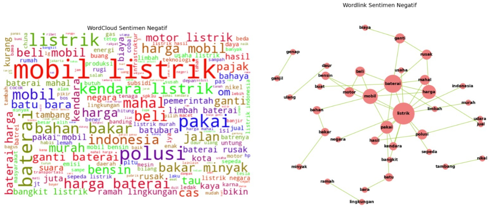

# Analisis Sentimen Publik terhadap Tren Kendaraan Listrik sebagai Alternatif Transportasi Ramah Lingkungan

## 📌 Latar Belakang

Kendaraan listrik kini mulai banyak dibicarakan sebagai solusi transportasi yang ramah lingkungan. Pemerintah juga sudah mendorong penggunaannya lewat subsidi dan insentif. Namun, belum semua masyarakat menerima hal ini dengan mudah. Ada yang mendukung karena dianggap lebih bersih dan modern, tapi ada juga yang masih ragu soal harga, daya tahan, dan infrastrukturnya. Oleh karena itu, analisis sentimen di media sosial menjadi penting untuk mengetahui bagaimana tanggapan publik secara lebih luas terhadap isu ini.

## ❓ Rumusan Masalah

1. Bagaimana sentimen publik terhadap kendaraan listrik sebagai solusi transportasi ramah lingkungan?
2. Bagaimana tanggapan publik terhadap aspek produk kendaraan listrik, seperti harga, performa, daya tahan, dan infrastruktur pendukungnya?
3. Sejauh mana merek kendaraan listrik memengaruhi opini dan sentimen publik?

---

## 📊 Hasil Analisis Sentimen Publik terhadap Kendaraan Listrik

Analisis sentimen dilakukan untuk mengidentifikasi persepsi dan pandangan masyarakat terhadap kendaraan listrik berdasarkan percakapan publik. Hasil analisis dikelompokkan menjadi tiga kategori, yaitu sentimen positif, negatif, dan netral. Interpretasi dilakukan dengan mengamati kata-kata dominan pada WordCloud serta keterkaitan antarkata melalui WordLink.

### 🟢 1. Sentimen Positif

| No. | Fokus Temuan | Kata Kunci Dominan | Insight |
|---|---|---|---|
| **1** | Kendaraan Listrik sebagai Solusi Ramah Lingkungan | Ramah, lingkungan, polusi, emisi, daur ulang | Masyarakat memandang kendaraan listrik secara positif karena potensinya dalam mengurangi polusi udara dan emisi. Kemunculan kata daur ulang juga menunjukkan perhatian terhadap keberlanjutan lingkungan. |
| **2** | Efisiensi Energi dan Teknologi Modern | Baterai, energi, panel surya, hemat, pakai | Kendaraan listrik dipandang sebagai bagian dari perkembangan teknologi energi masa depan. Efisiensi energi dan pemanfaatan energi terbarukan menjadi aspek yang diapresiasi. |
| **3** | Keuntungan Ekonomi dan Penghematan Biaya | Harga, hemat, murah | Faktor ekonomi menjadi salah satu daya tarik kendaraan listrik. Masyarakat menyoroti potensi penghematan biaya operasional dan penggunaan energi dalam jangka panjang. |
| **4** | Dukungan Pemerintah dan Pengembangan Industri | Pemerintah, produksi, negara, subsidi | Masyarakat menaruh harapan terhadap dukungan pemerintah dan industri dalam mendorong produksi, pengembangan, serta memperluas akses terhadap kendaraan listrik. |

### 🔴 2. Sentimen Negatif

| No. | Fokus Temuan | Kata Kunci Dominan | Insight |
|---|---|---|---|
| **1** | Kekhawatiran terhadap Baterai | Baterai, mahal, rusak, limbah, ganti | Baterai menjadi perhatian utama dalam sentimen negatif. Kekhawatiran mencakup harga, daya tahan, biaya penggantian, hingga potensi limbah yang dihasilkan. |
| **2** | Harga dan Keterjangkauan Kendaraan Listrik | Mahal, harga, beli, biaya, pajak | Tingginya biaya pembelian dan berbagai biaya terkait kendaraan listrik menimbulkan persepsi bahwa teknologi ini belum sepenuhnya terjangkau, khususnya bagi masyarakat menengah ke bawah. |
| **3** | Dampak Lingkungan dari Produksi Kendaraan Listrik | Polusi, limbah, tambang, batu bara, lingkungan, nikel | Muncul kritik terhadap dampak lingkungan dari rantai produksi kendaraan listrik. Aktivitas pertambangan nikel, penggunaan batu bara dalam pembangkitan listrik, dan pengelolaan limbah baterai menjadi perhatian publik. |
| **4** | Kesiapan Infrastruktur dan Keandalan Teknologi | Cas, ganti, pakai, kota, rusak | Masyarakat mempertanyakan kesiapan fasilitas pengisian daya dan keandalan kendaraan listrik. Hal ini turut memunculkan keraguan terhadap penggunaan kendaraan listrik di berbagai wilayah, terutama di luar perkotaan. |

### ⚪ 3. Sentimen Netral

| No. | Fokus Temuan | Kata Kunci Dominan | Insight |
|---|---|---|---|
| **1** | Informasi dan Perbandingan Kendaraan | Mobil, motor, kendaraan, listrik, beli, harga, bahan bakar | Percakapan didominasi pembahasan informatif mengenai kendaraan listrik, termasuk perbandingan dengan kendaraan konvensional, harga, dan penggunaannya. |
| **2** | Informasi Seputar Baterai | Baterai, daur ulang, mahal, rusak, ganti | Baterai menjadi salah satu aspek yang banyak dibicarakan. Pembahasannya mencakup daya tahan, proses penggantian, biaya, dan pengelolaan baterai tanpa selalu menunjukkan penilaian emosional tertentu. |
| **3** | Harga dan Ketersediaan Infrastruktur | Harga, beli, pajak, subsidi, murah, cas, jalan | Percakapan mencakup aspek ekonomi dan teknis, seperti harga kendaraan, kebijakan subsidi, pajak, fasilitas pengisian daya, serta ketersediaan infrastruktur pendukung. |
| **4** | Lingkungan dan Alternatif Energi | Lingkungan, polusi, energi, minyak, hidrogen, batu bara | Masyarakat membahas hubungan kendaraan listrik dengan isu lingkungan dan transisi energi, termasuk sumber energi alternatif serta dampak penggunaan energi fosil. |
| **5** | Mobilitas dan Transportasi Sehari-hari | Sepeda, jalan kaki, motor, kendaraan pribadi, ganjil genap | Kendaraan listrik turut dibahas dalam konteks kebutuhan mobilitas sehari-hari, termasuk pilihan moda transportasi, penggunaan kendaraan pribadi, dan kebijakan lalu lintas. |

- **Sentimen positif** didominasi apresiasi terhadap potensi kendaraan listrik dalam mengurangi polusi, meningkatkan efisiensi energi, serta memberikan penghematan biaya operasional.
- **Sentimen negatif** lebih banyak menyoroti tantangan pada aspek baterai, keterjangkauan harga, dampak lingkungan dari proses produksi, dan kesiapan infrastruktur.
- **Sentimen netral** memperlihatkan bahwa kendaraan listrik juga menjadi objek diskusi informatif, terutama terkait perbandingan kendaraan, spesifikasi baterai, harga, dan kebutuhan transportasi sehari-hari.

## 🔑 Key Findings

- **Sentimen negatif mendominasi** opini publik terhadap kendaraan listrik sebagai alternatif transportasi ramah lingkungan (**42.8% negatif**, **40.5% netral**, dan hanya **16.6% positif**), meski jaraknya dengan sentimen netral cukup tipis.
- Sentimen positif cukup signifikan pada aspek **pengurangan polusi udara**, namun tetap kalah dominan karena publik meragukan klaim "ramah lingkungan" akibat dampak proses produksi (terutama tambang nikel untuk baterai).
- **Isu baterai** menjadi topik paling sering dibahas, publik menyoroti baterai sebagai komponen paling bermasalah dari segi biaya, daya tahan, dan dampak lingkungan.
- **Isu infrastruktur (SPKLU)** juga banyak dibahas, publik ragu terhadap kesiapan dan pemerataan Stasiun Pengisian Kendaraan Listrik Umum di berbagai daerah Indonesia.
- **Persepsi merek** bervariasi:
  - Sentimen **positif** dominan: **BYD**
  - Sentimen **negatif** dominan: **Tesla** dan **Wuling**
  - Sentimen **netral** dominan: **Hyundai** dan **Toyota**
  - Kurang mendapat sorotan publik: **Honda, BMW, Nissan**
- Masih banyak keraguan publik terhadap kendaraan listrik yang mencakup biaya operasional, isu lingkungan dan keselamatan, hingga kesiapan infrastruktur dan regulasi yang menunjukkan perlunya **edukasi, transparansi, dan percepatan pembangunan ekosistem kendaraan listrik** secara menyeluruh.
- Mayoritas masyarakat menilai ada **kontradiksi** antara branding kendaraan listrik sebagai solusi ramah lingkungan dengan realita produksi baterai di Indonesia yang masih bergantung pada nikel, bahan yang dikenal merusak lingkungan pada proses ekstraksinya.

## 🛠️ Tools & Teknik

- Sentiment Analysis
- Topic Modeling (Clustering)
- Data Visualization

**Kata Kunci**
1. Kelemahan dan kelebihan kendaraan listrik
2. Kendaraan listrik ramah lingkungan
3. Subsidi pemerintah untuk kendaraan listrik: layak atau tidak?
